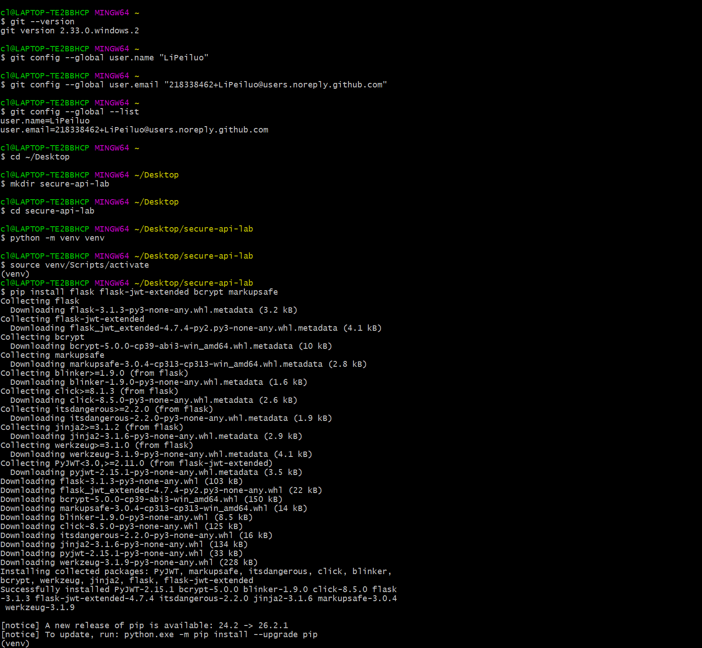
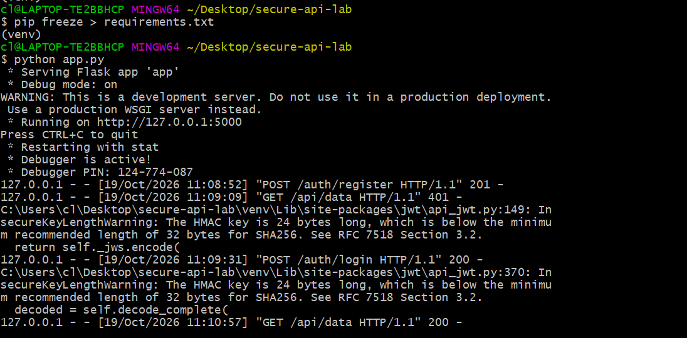
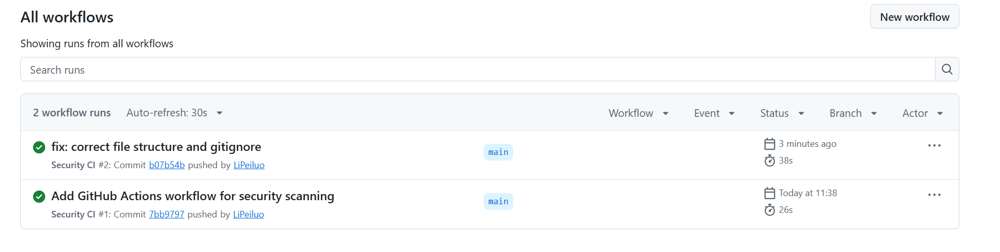
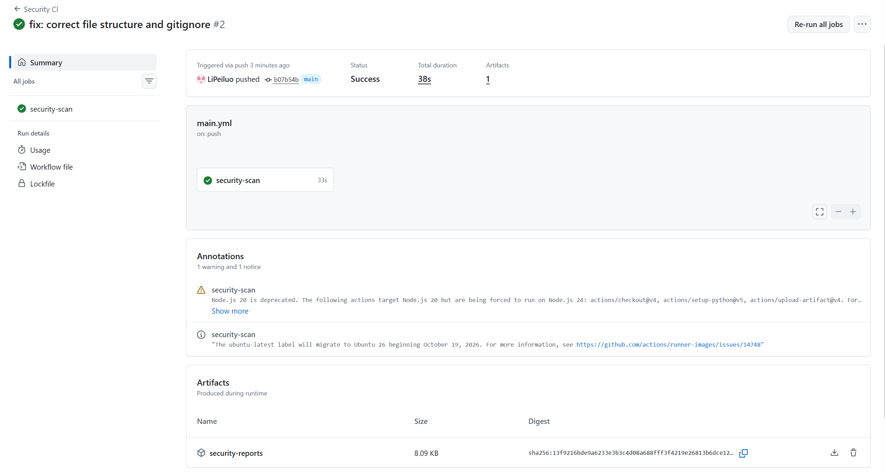
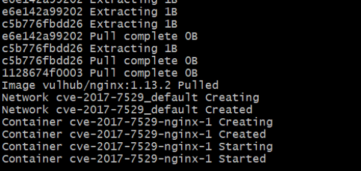
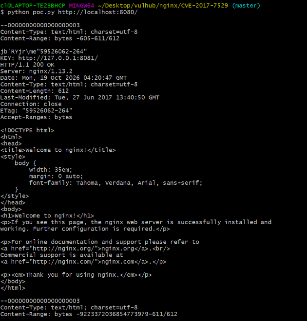
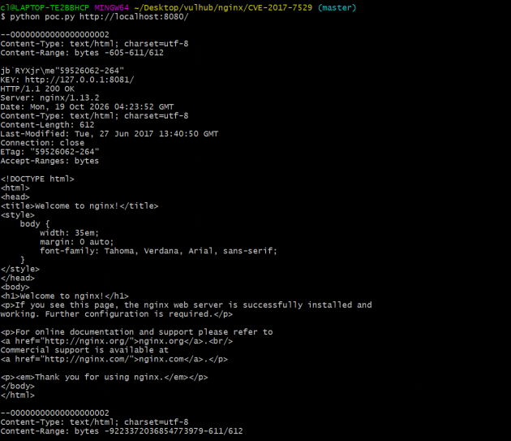
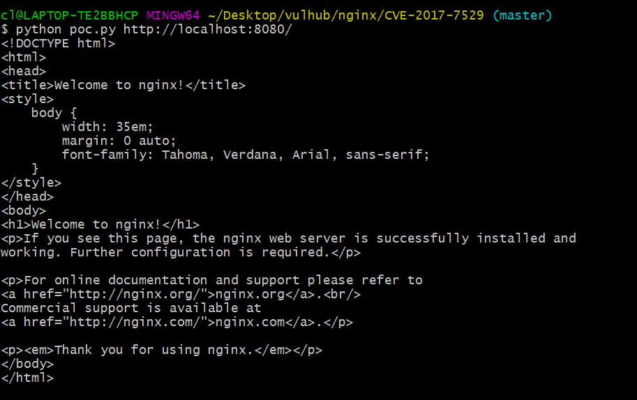

# Work 1: Secure REST API Development with CI/CD and Real CVE Vulnerability Analysis

**Student:** Peiluo Li (HDU Number: 23320303)  
**Repository:** [https://github.com/LiPeiluo/secure-api-lab](https://github.com/LiPeiluo/secure-api-lab)  
**Last successful pipeline run:** [https://github.com/LiPeiluo/secure-api-lab/actions/runs/39200444319](https://github.com/LiPeiluo/secure-api-lab/actions/runs/39200444319)

## 1. Purpose of the Work

The purpose of this work is to gain practical experience across the full security lifecycle of a backend application: developing a secure REST API with protection against the OWASP Top 10 weaknesses, integrating automated security scanning into a CI/CD pipeline, reproducing a real known vulnerability (CVE) in a controlled environment, analyzing its root cause, and verifying that the applied fix removes the vulnerability without breaking the normal functionality.

## 2. Project and API Description

The project is written in Python with the Flask framework and uses SQLite for storage. Access tokens are issued with Flask-JWT-Extended, and passwords are hashed with bcrypt. The project was created with a virtual environment and pip, initialized as a git repository, and linked to the remote GitHub repository listed above. Figure 1 shows the initialization of the project and the installation of the dependencies.

*Figure 1. Project initialization and dependency installation.*

The API implements three endpoints, listed in Table 1.

| Method | Endpoint | Access | Description |
| :--- | :--- | :--- | :--- |
| POST | `/auth/register` | public | creates an account with a bcrypt-hashed password |
| POST | `/auth/login` | public | verifies credentials and returns a JWT token |
| GET | `/api/data` | JWT required | returns a list of data records |

The endpoints are called with curl. Registration and login return a token, `/api/data` rejects requests without a token with HTTP 401 and answers with HTTP 200 when a valid token is provided in the Authorization header.

# 1. Register a new user (returns 201)
curl -X POST http://localhost:5000/auth/register \
  -H "Content-Type: application/json" \
  -d "{\"username\":\"alice\",\"password\":\"secret123\"}"

# 2. Login and receive JWT token (returns 200)
curl -X POST http://localhost:5000/auth/login \
  -H "Content-Type: application/json" \
  -d "{\"username\":\"alice\",\"password\":\"secret123\"}"

# 3. Access protected data (401 without token, 200 with token)
curl http://localhost:5000/api/data \
  -H "Authorization: Bearer <your_token_here>"

Figure 2 shows the running server and the recorded requests.

*Figure 2. Testing the API: registration, denied access without a token, and successful login.*

## 3. Implemented Security Measures

### 3.1 Protection Against SQL Injection
All database access uses SQLite parameterized queries. Values are passed as query parameters with the `?` placeholder and are never concatenated into the SQL string, so injected SQL fragments are treated as pure data and cannot change the query structure:

conn.execute(
    'INSERT INTO users (username, password_hash) VALUES (?, ?)', 
    (username, hashed)
)

### 3.2 Protection Against XSS
Every piece of user-controlled data returned in a response is escaped with the `markupsafe` `escape()` function before it is placed into the JSON payload. This ensures that injected markup, such as `<script>`, is neutralized and treated as harmless text:

from markupsafe import escape

sample = [{"id": 1, "title": str(escape("Test data <script>"))}]
return jsonify({"data": sample}), 200

### 3.3 Authentication: JWT and Password Hashing
Passwords are never stored in plaintext: they are hashed with `bcrypt` together with a per-user salt, and verification is performed with `bcrypt.checkpw`. On successful login, the server issues a JWT access token. Every protected endpoint is guarded by the `@jwt_required()` decorator from Flask-JWT-Extended, which automatically rejects requests without a valid token. To prevent username enumeration, login errors return the exact same message for a nonexistent user and for a wrong password:

# Password Hashing
hashed = bcrypt.hashpw(password.encode("utf-8"), bcrypt.gensalt())

# JWT Token Generation
token = create_access_token(identity=str(row[0]))

# JWT Protection Middleware
@app.route("/api/data", methods=["GET"])
@jwt_required()
def get_data():
    # ...

## 4. CI/CD Pipeline with Security Scanners

The repository contains a GitHub Actions workflow (`.github/workflows/main.yml`) named **Security CI** that runs automatically on every push to the `main` branch and on every pull request. The job checks out the code, installs the dependencies, and runs two security tools:
* **SAST (Static Application Security Testing)**: Bandit statically analyzes the Python source code for common security issues.
* **SCA (Software Composition Analysis)**: Safety checks the pinned dependencies in `requirements.txt` against a database of known vulnerabilities.

Both tools produce JSON reports, which are uploaded as an artifact named `security-reports`, ensuring that every run keeps its full scan results.

steps:
  - name: Run Bandit (SAST)
    run: bandit -r . -f json -o bandit-report.json || true
  
  - name: Run Safety (SCA)
    run: safety check --json > safety-report.json || true
  
  - name: Upload security reports
    uses: actions/upload-artifact@v4
    with:
      name: security-reports
      path: |
        bandit-report.json
        safety-report.json

Two runs of the pipeline have completed successfully, as shown in Figure 3. The reports of both tools are available as the `security-reports` artifact of each run (Figure 4). The scans confirmed that no critical vulnerabilities are present in the application code or in the pinned dependencies.

*Figure 3. The Security CI workflow: two successful runs on main.*

*Figure 4. Run summary with the security-reports artifact (SAST and SCA reports).*

## 5. The Selected Vulnerability: CVE-2017-7529

For the vulnerability analysis part, CVE-2017-7529 in the nginx web server was selected. The vulnerability is an integer overflow in the range filter module of nginx, affecting versions 0.5.6 through 1.13.2. When nginx serves a request that contains a crafted Range header with a negative offset, the module computes the start of the requested byte range incorrectly: the arithmetic overflows, and the server reads a part of the response file that lies outside the requested range. The response then includes up to about 611 bytes of internal data that precedes the actual file content, which in a caching configuration contains the header of the cache file with internal metadata such as the upstream response headers. An attacker can therefore obtain information that was never meant to be returned to a client.

**Reference:**  
[1] National Vulnerability Database (NVD): CVE-2017-7529. Available at: https://nvd.nist.gov/vuln/detail/CVE-2017-7529

## 6. Reproducing the Vulnerability

The vulnerable environment was taken from the Vulhub project. After cloning the repository, the environment is started with Docker Compose, which pulls the vulnerable nginx 1.13.2 image and starts the container (Figure 5):

git clone https://github.com/vulhub/vulhub.git
cd vulhub/nginx/CVE-2017-7529
docker-compose up -d

*Figure 5. The vulnerable nginx 1.13.2 container started from Vulhub.*

The exploitation script `poc.py` from the Vulhub directory sends two requests with negative Range headers, one with the default over-read length and one with an extreme value:

python poc.py http://localhost:8080/

Both requests are answered with HTTP 200 and a Content-Range header that exposes the overflowed value, and the response body contains 611 bytes read from before the file content. In the captured output, the leaked fragment includes internal values such as the cache key address `KEY: http://127.0.0.1:8081/`, which a normal client should never receive (Figures 6 and 7). The attack is therefore reproduced successfully.

*Figure 6. Reproduction with the default range: the response leaks internal data.*

*Figure 7. Reproduction with the extreme negative offset: the overflow is confirmed.*

## 7. Root Cause Analysis

The root cause of CVE-2017-7529 is the combination of an arithmetic overflow and a missing boundary check in the range filter module. For a suffix range of the form `bytes=-N`, the module computes the start of the range as the file size plus the negative offset. With an extreme value of N the addition overflows the underlying integer, and the resulting start value passes the module validation although it points far outside the file. The module then returns bytes that precede the requested file in the response buffer; in a caching setup, this is the cache file header that stores the internal upstream response metadata. In short, the error is improper input handling of the Range header combined with the absence of a strict validation of the computed range boundaries.

## 8. Applied Fix and Verification

The fix removes the vulnerability by upgrading the Nginx server to a patched version. In the environment configuration, the image was changed from the vulnerable `vulhub/nginx:1.13.2` to the official `nginx:1.13.3` release, which contains the corrected range filter module.

To ensure the configuration remained compatible, a custom `Dockerfile` was created to build the container from the patched base image while preserving the original `default.conf` provided by Vulhub:

FROM docker.m.daocloud.io/library/nginx:1.13.3

The `docker-compose.yml` file was updated to build from this Dockerfile instead of pulling the vulnerable image:

services:
  nginx:
    build: .
    volumes:
      - ./default.conf:/etc/nginx/conf.d/default.conf
    ports:
      - "8080:8080"

The environment was rebuilt using the following commands:

docker compose down
docker compose up --build -d

After the fix, the same exploitation steps from Chapter 6 were repeated as regression verification. The `poc.py` script no longer returns any internal data. As shown in Figure 8, the response to the negative range request only contains the standard HTML of the Nginx welcome page. The leaked cache header fragment (including `HTTP/1.1 200 OK` and the `KEY` entry from Figures 6 and 7) is completely gone, confirming that the integer overflow vulnerability has been successfully mitigated. Furthermore, the server continues to serve the normal page content without crashing, proving that the main functionality is not affected.

*Figure 8. Verification of the fix: the attack no longer leaks internal data and returns only the normal page content.*

The modified `docker-compose.yml` and the new `Dockerfile` are included in the `fixes/` folder of the repository.

## 9. Conclusion

In this work, a secure REST API was developed with Flask, protected with parameterized queries, output escaping, bcrypt password hashing, and JWT-based authentication, and equipped with an automated GitHub Actions pipeline running Bandit (SAST) and Safety (SCA) on every push. A real vulnerability, CVE-2017-7529, was reproduced in the controlled Vulhub environment, analyzed down to the integer overflow in the range filter module, and eliminated by upgrading the server, with the fix verified by repeating the attack.

The work demonstrates that security must be addressed at several levels at once: in the application code, in the dependencies through automated scanning, and in the runtime environment through timely updates.